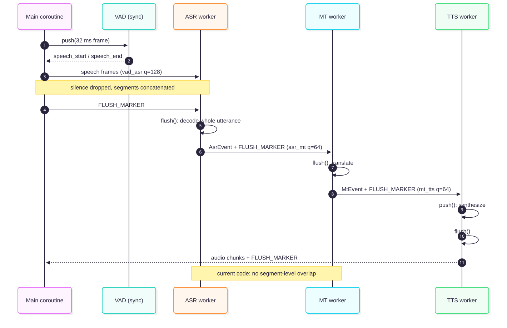

# Architecture

OneVoice is a **cascade**: VAD → ASR → MT → TTS. It is not direct
speech-to-speech translation.


ASR runs on the source language; TTS selects the voice for the target language;
MT may be direct or pivot through English.

## Stages

| Stage | Role | Implementations |
|---|---|---|
| VAD | Gate speech, drop silence | Silero (EnergyVAD remains a test baseline) |
| ASR | Speech → source text | wav2vec2 + KenLM, Whisper, PhoWhisper |
| MT | Source text → target text | envit5, madlad, m2m100, `PivotMT` |
| TTS | Target text → audio | Piper, VieNeu-TTS, `language_router` |

All components have the same streaming shape: `push()` → `flush()` → `reset()`
(D6). Batch models buffer until `flush()`; there is no separate batch interface.

`pipeline.py` is the sequential reference. `async_pipeline.py` is the deployed
driver with bounded queues and worker threads.

## Language routing

`languages.src` and `languages.tgt` select a pair from `L = {vi, en, zh, ko}`;
`src == tgt` is not a translation task.

- ASR must accept the source language.
- MT must support `src→tgt`, directly or through `PivotMT`.
- `language_router` must have a TTS backend for the target language.

A pair is **configurable** when those three conditions hold. It is **validated**
only when measured end-to-end; see the coverage table in the project README.

## Async pipeline



The diagram follows one utterance. ASR and MT still batch their input until
`flush()`; there is no segment-level decode/translate overlap.

### Audio frames

`onevoice.audio.chunk_audio()` slices the utterance into **32 ms frames**
(`DEFAULT_FRAME_MS = 32`). The final partial frame is kept, so a `speech_end`
cannot vanish in the tail. Frames are read-only views over the input array.

### VAD gating

VAD is not an `AsyncComponent` and has no queue. `_feed_vad_to_asr()` calls
`vad.push(frame)` synchronously for every frame:

1. Append the frame to a `LookbackBuffer` (500 ms, D42/Q7).
2. On `speech_start`, replay every buffered frame since `event.t_audio` into
   the ASR input queue. This recovers the onset that a lookahead detector
   confirms retroactively (Silero lookahead ≈ 62 ms).
3. While `speaking`, forward each frame once.
4. On `speech_end`, stop forwarding. Silence between segments is dropped.
5. After the last frame, call `vad.flush()` to collect a final `speech_end`.

Multiple speech segments in one utterance are handled in the same pass:
`speaking` toggles per segment, and only speech frames are enqueued. The gaps
are removed and the speech frames are concatenated in order. There is **no
per-segment flush**: one utterance still ends with one `FLUSH_MARKER`.

If a detector asks for audio older than the 500 ms window, `LookbackUnderrun`
is raised: the run fails loudly instead of replaying a clipped prefix and
reporting a plausible-looking transcript.

### Queues and workers

| Queue | Max size | Producer → consumer |
|---|---|---|
| `vad_asr` | 128 in deployment configs | main coroutine → ASR worker |
| `asr_mt` | 64 | ASR worker → MT worker |
| `mt_tts` | 64 | MT worker → TTS worker |
| TTS output | unbounded | TTS worker → collector |

ASR, MT and TTS each run as an `AsyncComponent` task. `QueueItem` carries
`payload`, `pushed_at` and `utterance_id`; each stage records
`<queue>_wait_ms` when it pops an item. CPU work runs in
`asyncio.to_thread(...)`, so a slow model does not block the event loop.

Bounded queues provide backpressure: when ASR is behind, `await queue.put()`
in the VAD feed suspends the producer instead of growing memory without bound.

### Per-stage behaviour

| Stage | `push()` | `flush()` |
|---|---|---|
| ASR | appends the frame to a list; returns `[]` | concatenates all frames, runs one decode, returns one `AsrEvent` |
| MT | unwraps `AsrEvent.text`, appends to `_segments`; returns `[]` | joins segments, generates one translation, returns one `MtEvent` |
| TTS | synthesizes the received text, returns `TtsEvent[]` | marks flushed, returns `[]` |

`FLUSH_MARKER` is the end-of-utterance signal. It travels stage by stage:

```text
main: feed all frames → put(FLUSH_MARKER) into vad_asr
ASR:  flush() → AsrEvent + FLUSH_MARKER into asr_mt
MT:   push(text) → flush() → MtEvent + FLUSH_MARKER into mt_tts
TTS:  push(text) → synth → flush() → FLUSH_MARKER into output
main: collect TTS audio chunks until FLUSH_MARKER
```

The current pipeline overlaps **VAD feeding with ASR accumulation**, and runs
ASR/MT/TTS as concurrent stages. It does **not** overlap ASR decoding of
segment *n* with MT translation of segment *n−1*: both hold input until the
utterance-level flush.

### Timing

- `ASR_FINAL` on the ASR side; `ASR_FIRST_PARTIAL` when a backend emits
  partials; `MT_DONE` on MT; `TTS_FIRST_AUDIO` / `TTS_DONE` on TTS.
- `push()` time is recorded as `<stage>_process_ms`; `flush()` time as
  `<stage>_flush_ms`.
- `_collapse_timing()` sums process/flush times (total stage cost) and averages
  queue waits. The record keeps `*_n` counts.
- `pipeline_rtf` spans `stream_start` → `tts_done`; `rtf` starts at
  `speech_end`. The difference is `streaming_cost` (Q6).

### Limits

- ASR and MT are utterance-batch, so the async gain is mostly queue overlap,
  not decode/translate pipelining.
- The cheapest overlap win is MT→TTS sentence chunking: split the final MT
  text and synthesize sentence by sentence to move `tts_first_audio` earlier.
- ASR→MT segment overlap is the larger win but quality-risky: it needs
  segment-final ASR and per-segment MT, and named entities/numbers can regress.
- `await asyncio.sleep(0.1)` after the ASR flush is a timing crutch; it is not
  a completion condition and should be replaced by an explicit event.

## Code map

| Path | Contents |
|---|---|
| `src/onevoice/pipeline.py` | sequential driver |
| `src/onevoice/async_pipeline.py` | async driver, queues, `FLUSH_MARKER` |
| `src/onevoice/components/` | VAD, ASR, MT, TTS implementations |
| `src/onevoice/interfaces/` | `BaseASR`, `BaseMT`, `BaseTTS`, `BaseVAD` |
| `src/onevoice/eval/` | metrics, manifest, report; no model imports (D5) |
| `src/onevoice/config.py` | YAML config, `languages.src` / `languages.tgt` |
| `src/onevoice/registry.py` | component registry |

## Diagrams

Source is `docs/diagrams/*.mmd`; SVG is committed so viewing needs no Node.
To edit:

```bash
./scripts/render_diagrams.sh
```

Requires Node/npx; the first run downloads Chromium. Mermaid CLI is pinned to
`12.0.0` in the script.
